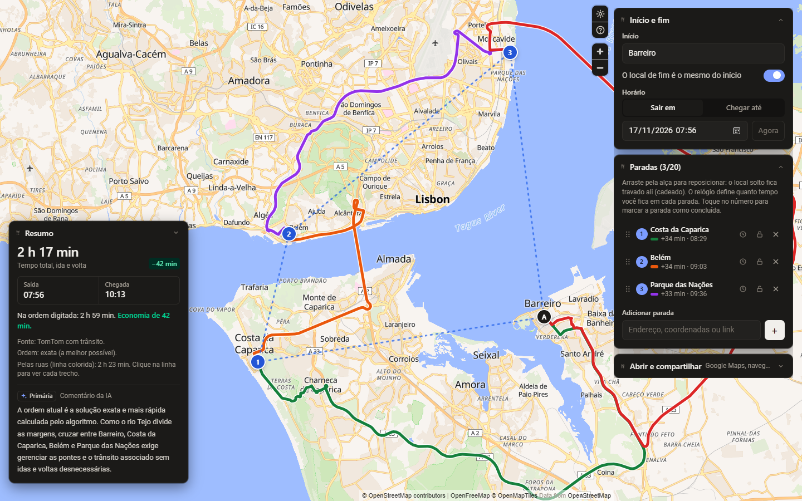
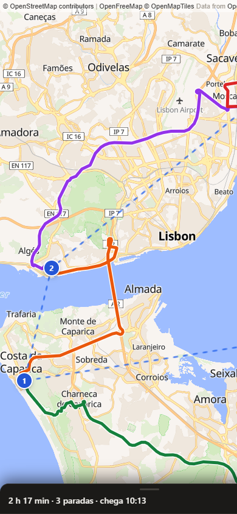

<div align="center">


# Project GPS Route Planner · Planejador de rotas

### A melhor ordem para as suas paradas de carro, com trânsito real, traçado pelas ruas e tempo em cada parada.

[](https://github.com/giosepeluiz/project-gps-route-planner)
[](https://rotas.arqueirover.de)
[](https://nextjs.org)
[](https://www.typescriptlang.org)
[](LICENSE)

**[🌐 Acessar](https://rotas.arqueirover.de)** · **[📖 Como usar](#-como-usar-passo-a-passo)** · **[⚙️ Como funciona](#️-como-funciona-por-dentro)** · **[🛠️ Desenvolvedores](#️-para-desenvolvedores)** · **[🤝 Contribuir](#-código-aberto-contribua)**



</div>

> 🇬🇧 **English summary:** *Route planner* finds the best order for a car trip with up to 20 stops, using real traffic times (TomTom), road routes that never cross the sea by ferry (bridges and tunnels are fine), and how long you stay at each stop. Drag stops to lock them in place, mark them as done along the way, and open turn-by-turn navigation in Google Maps, Waze or Apple Maps. An optional AI (Gemini, with Groq as backup) comments on the order, and any suggestion is checked against real travel times before it's offered. Available in Brazilian and European Portuguese, British English and Spanish. Built with Next.js and MapLibre, no Google Maps APIs. Open source under the MIT license.

---

## 👋 Olá!

Planejar um dia com várias paradas de carro parece simples até a terceira parada: qual ordem perde menos tempo no trânsito? Vale a pena atravessar a ponte agora ou na volta? A que horas eu chego, se fico meia hora em cada lugar?

O **Planejador de rotas** nasceu para responder isso de um jeito direto: você coloca o início, as paradas e, se quiser, um fim diferente. Ele calcula a melhor ordem com o **trânsito real**, desenha o caminho **pelas ruas** e mostra a que horas você chega e sai de cada lugar. Depois é só abrir a navegação no app que você já usa.

É um projeto pessoal, feito para o dia a dia, sem conta, sem senha e sem anúncios. Ainda está em **beta** até a versão 1.0.

## ✨ O que ele faz

| | |
|---|---|
| 🧭 **Melhor ordem de verdade** | Até 10 paradas, a ordem exata (a mais rápida possível); de 11 a 20, uma heurística muito boa |
| 🚦 **Trânsito real** | Tempos da TomTom com trânsito ao vivo (saída na próxima hora) ou histórico (saídas futuras) |
| 🛣️ **Traçado pelas ruas** | Cada trecho numa cor; clique num trecho para ver a distância e o tempo dele |
| 🌊 **Sem atravessar o mar** | Balsas não contam; pontes, túneis e trens de carros (como o Eurotúnel), sim |
| ⏱️ **Tempo em cada parada** | Diga quanto tempo fica em cada lugar e o total, as chegadas e as saídas se ajustam |
| 🔒 **Ordem manual** | Arraste uma parada e ela fica travada ali; o resto continua otimizado em volta |
| ✅ **Durante a viagem** | Marque as paradas concluídas: ficam riscadas e o trecho fica cinza no mapa |
| 📲 **Navegação no seu app** | Abra a rota inteira no Google Maps ou navegue até a próxima parada no Google Maps, Waze ou Apple Maps |
| 🔎 **Busca que entende** | Endereço com sugestões enquanto digita, coordenadas em vários formatos e links de 10 apps de mapas |
| 🏘️ **Nome da zona** | Coordenadas viram o nome do bairro ou da freguesia, fácil de reconhecer |
| ✨ **IA que comenta (opcional)** | Explica a ordem e, se sugerir outra, ela é conferida com os tempos reais antes de virar botão |
| 🌍 **4 idiomas** | Português (Brasil e Portugal), inglês e espanhol; abre no idioma do aparelho |
| 🌗 **Do seu jeito** | Tema claro ou escuro, tamanho do texto e blocos que você arrasta para onde quiser |
| 📱 **Computador e celular** | No celular os blocos ficam numa gaveta; dá para adicionar à tela inicial |

## 🌐 Acesse

O app roda no navegador, sem instalar nada: **[rotas.arqueirover.de](https://rotas.arqueirover.de)**.

No celular, use **Adicionar à tela inicial** (Chrome) ou **Compartilhar → Adicionar à Tela de Início** (Safari): ele abre em tela cheia, com o próprio ícone. Os blocos ficam numa gaveta embaixo; toque nela para abrir.

<p align="center">

</p>

> [!NOTE]
> Na primeira visita o app abre **vazio**, sem rota de exemplo. A rota e as preferências ficam **só no seu navegador**: o que você preencher volta na próxima visita. Nada é salvo num servidor, e uma rota montada no computador não aparece no celular.

## 📖 Como usar, passo a passo

### 1. Início, fim e horário

1. No bloco **Início e fim**, digite o ponto de partida. Vale endereço, coordenadas (`38.7434, -9.1593`, `38°44'36"N 9°09'33"W`…) ou um link de mapa. O botão de **alvo** ao lado do campo usa a sua localização (GPS); vale também para o fim.
2. Por padrão a rota volta ao início. Desligue **O local de fim é o mesmo do início** para escolher outro fim (ou nenhum: aí a rota termina na última parada).
3. Escolha **Sair em** ou **Chegar até** e o horário. Em **Agora**, vale o trânsito ao vivo.

### 2. Paradas

- **Digite** no campo **Adicionar parada**: a partir de 3 letras aparecem sugestões; escolha com o mouse ou com as setas e Enter.
- **Clique com o botão direito** no mapa (ou toque longo no celular) para pôr uma parada ali, com **Desfazer**.
- **Clique** em qualquer ponto do mapa para ver o endereço e escolher: adicionar como parada, usar como início ou como fim.
- Também dá para escrever uma frase, como *"farmácia perto do Colombo e depois Belém"*: a IA separa os lugares e cada um é buscado normalmente.

A lista se **reorganiza sozinha** na melhor ordem. Em cada parada:

| Controle | O que faz |
|---|---|
| ⠿ **Alça** | Arraste para mudar a ordem; a parada fica travada onde você soltar |
| **Número** | Toque para marcar como **concluída** (de novo para desfazer) |
| 🕐 **Relógio** | Quanto tempo você fica ali: uma lista de 5 min a 2 h, ou **Outro…** para escolher horas e minutos |
| 🔒 **Cadeado** | Trava ou destrava a parada na posição atual |
| ✕ | Remove a parada |

**☕ Pausa para descanso:** o botão **+ Pausa para descanso** abre uma janela que pergunta quanto tempo de pausa e em que trecho ela fica. A pausa funciona como uma parada sem local: entra na lista, soma o tempo dela aos horários e já começa **travada** no trecho escolhido. Depois dá para arrastá-la para outro trecho e mudar o tempo pelo relógio. Pode haver quantas pausas quiser, mas **duas não podem ficar juntas**.

### 3. Resumo

O **Resumo** mostra o tempo total (direção + paradas), a saída, a chegada, a **distância total** e quanto você economiza em relação à ordem digitada. O ícone **ⓘ** explica de onde vêm os tempos e se a ordem é exata. Com travas, ele diz quanto a rota levaria sem elas.

Se a IA estiver ligada, ela comenta a ordem. Quando sugere outra, o app **confere com os tempos reais**: o botão **Aceitar sugestão** só aparece se a sugestão for mesmo mais rápida (com até 10 paradas e sem travas, a ordem já é a melhor possível e a IA nem sugere).

### 4. Modo viagem

**▶ Iniciar viagem**, no Resumo, acompanha a viagem pelo GPS do aparelho. Antes de começar, um aviso lembra que o planejador **não é um GPS de navegação**: conduza com o seu app de navegação preferido (o botão **Ciente** começa a viagem).

- **Zoom de perto:** no celular e no tablet, com o carro andando a câmera se aproxima bem da seta, como no Waze; a seta e a linha engrossam junto com o zoom. Parado, o mapa se afasta em 2D e mostra o que falta da rota.
- **Começou no meio do caminho?** A linha começa onde você está e a saída é deduzida pela posição.
- **Seta no mapa, em 3D:** a sua posição aparece como uma seta que desliza entre as leituras do GPS (sem pulos), gruda na via da rota quando está perto dela e aponta para onde a via segue. O mapa se inclina, como nos GPS.
- **Linha que acompanha o carro:** o pedaço do trecho que você já percorreu some junto com a seta, e o tempo e a distância até a próxima parada vão diminuindo ao vivo.
- **Girar o mapa:** com o botão de bússola (junto das configurações), a direção da viagem fica para cima. No celular e no tablet ele já começa ligado; no computador, começa com o norte para cima.
- **Saiu da rota?** Duas leituras seguidas longe da linha pedem uma rota nova na hora, saindo **no sentido em que o carro já está** (sem mandar dar meia-volta). Fora isso, a rota é recalculada com o trânsito a cada 2 minutos (ou antes, se você andar mais de 3 km), para poupar a cota dos serviços.
- **No celular e no tablet**, um cabeçalho mostra a **hora de chegada**, o **tempo** e os **km** que faltam até a próxima parada; o nome dela fica no rodapé. Os botões do mapa ficam maiores.
- **⏸ Pausar** e **⏹ Encerrar** a qualquer momento. Ao chegar numa parada, a viagem pausa sozinha; **▶ Retomar viagem** marca a parada como concluída e segue para a próxima.
- **Seta na direção do movimento:** a seta e o mapa giram para o lado em que o carro está indo (a direção do GPS), como no Waze.
- **No celular**, ao iniciar a viagem a gaveta recolhe e mostra só a próxima parada.
- **Ao concluir**, uma janela mostra as **estatísticas**: tempo, chegada e distância previstos × reais, paradas concluídas, tempo parado e velocidade média em movimento. Um resumo fica também no aviso de viagem concluída.
- **Estatísticas anônimas (opcional):** na mesma janela, o app pergunta se você quer enviar os números da viagem para ajudar a melhorar o planejador. Vão só números (distâncias, tempos previstos e reais de cada trecho e parada, uso do pausar, paradas longas sem pausar, pausas para descanso, recálculos) e dados técnicos do aparelho (modelo, tela, navegador): **nada de localização, nomes de lugares ou dados pessoais**. Dá para ver o texto antes de enviar e, se quiser, receber uma cópia por e-mail. O e-mail chega no idioma do app, com logo, tabelas e valores coloridos (verde, âmbar ou vermelho conforme o desvio do previsto) e uma **análise técnica feita por IA**, que compara o tempo real com o calculado trecho a trecho. Depois de um envio, a opção some por 30 minutos, e viagens quase sem distância ou tempo não são enviadas.

### 5. No mapa

- **Linha azul pontilhada:** as retas entre os pontos.
- **Linha colorida:** o caminho pelas ruas, uma cor por trecho. Clique num trecho para ver a distância e o tempo; os outros ficam semitransparentes.
- Trechos de paradas concluídas ficam **cinza**.
- O mapa se reenquadra quando a rota muda, sempre no espaço que os blocos deixam livre.

### 6. Abrir e compartilhar

| Ação | O que faz |
|---|---|
| **Abrir no Google Maps** | A rota inteira, na ordem otimizada (dividida em partes se tiver paradas demais para um link) |
| **Navegar até a próxima** | Ícones do **Google Maps**, **Waze** e **Apple Maps**, direto para a próxima parada não concluída |
| **Copiar rota** | O roteiro em texto, com horários, no idioma da interface |
| **Compartilhar** | A folha de compartilhamento do celular (onde o navegador oferece), com o link da rota |
| **Copiar link da rota** | Um endereço que abre a mesma rota em qualquer aparelho |
| **Relatório de saída (PDF)** | Documento formal com mapa, sequência de paradas, horários, km, pausas e o comentário da IA; abre a janela de impressão, de onde se salva o PDF |

**Link da rota.** São aceitos dois formatos; o link leva só coordenadas, tempos, travas, pausas e a hora (os nomes são buscados de novo por quem abre):

```text
https://rotas.arqueirover.de/r/<início>/<fim>/<parada1>/<parada2>/…[/<hora>]
https://rotas.arqueirover.de/?s=<início>&e=<fim>&p1=<parada1>&p2=<parada2>…[&t=<hora>]
```

- **Local:** `lat,lng` com ponto decimal, como `38.7075,-9.1364`. O tempo de permanência vai depois de `@`, em minutos: `38.7253,-9.15@10`.
- **Fim:** `s` volta ao início; `-` (ou, nos parâmetros, não pôr o `e`) termina na última parada; ou as coordenadas de outro lugar.
- **Pausa para descanso:** `b20` (20 minutos) no lugar de uma parada.
- **Parada travada** na posição: `!` no fim, como `38.7253,-9.15@10!`.
- **Hora:** `d` (sair em) ou `a` (chegar até) seguido de `AAAAMMDDhhmm`, como `d202611200830`. No caminho é o último segmento; nos parâmetros, `t=`.
- Exemplo: `/r/38.7075,-9.1364/s/38.7253,-9.15@10!/b20/38.7445,-9.1745/d202611200830`.

### 7. Personalizar

- **⚙️ Configurações** (ao lado do zoom): idioma, tema, tamanho do texto, tempo padrão nas paradas novas e voltar os blocos ao lugar padrão.
- **Blocos:** no computador, arraste cada bloco pelo título. Perto da borda esquerda ou direita ele gruda numa coluna; perto do topo ou da base, gruda na margem.
- **Tutorial:** na primeira visita, balões azuis explicam cada parte da tela (com **Pular tutorial**). Para ver de novo: Configurações → Ajuda.
- **❓ Sobre:** autoria, contatos, serviços e IAs em uso (com o estado de cada um) e as informações técnicas, com um botão para copiá-las.

> 💾 **Tudo fica guardado no navegador:** a rota, o horário de saída ou de chegada, as travas, as paradas concluídas, as pausas para descanso, o tempo em cada parada, o idioma, o tema, o tamanho do texto e a posição dos blocos. Ao abrir de novo, o app pergunta se você quer **continuar de onde parou** ou **começar uma nova rota** (que apaga tudo, menos as configurações).

## 🌍 Idiomas

| Idioma | Quando aparece |
|---|---|
| 🇧🇷 Português (Brasil) | Aparelho em português do Brasil |
| 🇵🇹 Português (Portugal) | Aparelho em português de Portugal, Angola, Moçambique e outros países lusófonos |
| 🇬🇧 English (UK) | Aparelho em inglês, ou em qualquer idioma que o app ainda não tem |
| 🇪🇸 Español | Aparelho em espanhol |

O idioma pode ser trocado em **Configurações → Idioma**. O comentário da IA e o texto da rota copiada saem no idioma escolhido.

## 🔐 Privacidade

- **Sem conta, sem senha e sem rastreamento.** A rota e as preferências ficam só no seu navegador.
- Para calcular a rota, o servidor recebe **só as coordenadas** e o tempo em cada parada; os nomes ficam no seu aparelho.
- A IA recebe **só os nomes dos lugares, a ordem e os minutos de cada trecho** (nunca coordenadas), ou o texto que você digitou para ela separar.
- As **chaves dos serviços ficam no servidor** e nunca chegam ao navegador.
- As **estatísticas anônimas** só saem se você aceitar, sem localização nem nomes. A IA da análise recebe só os números.

### Segurança

- Todo pedido à API é **validado campo a campo** (zod), com **tamanho máximo** do corpo e **limite de pedidos por IP**.
- O **link da rota** só aceita coordenadas, minutos e pausas; qualquer outra coisa é recusada (não há como injetar HTML ou texto).
- O **e-mail** das estatísticas tem uma versão em texto e outra em HTML montada no servidor, com **todo valor escapado** (inclusive o texto da IA, que ainda é validado e limpo de `<` e `>`); sem anexos nem scripts. Vai para um destino fixo e aceita a cópia em CC apenas para um e-mail válido. Um envio a cada 30 minutos por IP.
- Os **links de mapas** são resolvidos só em uma lista fixa de serviços, conferindo cada redirecionamento.
- Cabeçalhos de segurança: **Content-Security-Policy** (scripts só do próprio site, conexões só com o próprio servidor e o servidor de mapas), `X-Frame-Options`, `X-Content-Type-Options`, `Referrer-Policy`, `Permissions-Policy` e HSTS.

## ⚙️ Como funciona por dentro

### Tempos de viagem

O navegador manda os locais para `POST /api/plan`, que monta a matriz de tempos, roda o algoritmo e devolve a ordem, os trechos e o traçado. A fonte dos tempos aparece sempre no Resumo:

1. **TomTom Matrix Routing v2**, com trânsito ao vivo (saída na próxima hora) ou histórico (saídas futuras).
2. **OpenRouteService**, sem previsão de trânsito, se a TomTom falhar.
3. **Estimativa por distância** (linha reta × 1.4 a 35 km/h), o último recurso, sempre identificada como estimativa.

Cada serviço tem tempo limite de 8 s, uma nova tentativa e um *circuit breaker* que o pausa por 60 s depois de 3 falhas seguidas. O cache é por par de locais e faixa de 15 minutos, então uma parada nova só consulta os pares novos.

### A ordem das paradas

A ordem vem **sempre do algoritmo** (`src/lib/solver.ts`), nunca da IA:

- **Até 10 paradas:** solução exata por programação dinâmica (Held-Karp), com início e fim fixos.
- **De 11 a 20:** vizinho mais próximo + 2-opt + Or-opt, com aviso de ordem aproximada.
- **Travas:** as paradas travadas ficam na posição; as outras são otimizadas em volta.
- **Chegar até:** a saída é a chegada menos a duração; como o trânsito depende da hora, o cálculo se repete até a saída ficar na mesma faixa de 15 minutos (no máximo 3 vezes).

### Sem atravessar o mar

Carro não anda sobre a água. O traçado de cada trecho pede à TomTom para evitar balsas e marcar os trechos de balsa; como o "evitar" dela é só uma preferência, **uma rota que ainda venha com balsa é recusada**. Pontes, túneis e trens de carros continuam valendo. Quando não existe caminho por terra, o app avisa em vez de inventar um tempo.

Um detalhe: com trânsito ao vivo, uma interdição momentânea (uma praça fechada, por exemplo) pode fazer a TomTom dizer "sem rota". Antes de acreditar, o app confere com o trânsito histórico.

### A IA (opcional)

| | Serviço | Modelo padrão |
|---|---|---|
| Primária | Google Gemini (AI Studio) | `gemini-3.5-flash-lite` |
| Reserva | Groq | `openai/gpt-oss-120b` |

As respostas são validadas (zod). Sem resposta, vale o algoritmo local, e a tela nunca fica esperando a IA. Ela é instruída a agrupar as paradas de cada margem de um rio (como o Tejo) e nunca sugerir mais travessias que a ordem atual; e, de qualquer forma, **nenhuma sugestão aparece sem passar pelos tempos reais**.

### Busca de endereços

- **Coordenadas e links** com a posição são lidos no próprio navegador. Formatos: decimal, graus-minutos-segundos e graus-minutos, com vírgula ou ponto; links de Google Maps, Waze, Apple Maps, TomTom, HERE, Yandex, Organic Maps, OpenStreetMap, Bing e `geo:`.
- **Links curtos** passam por `/api/resolve`, que só acessa uma lista fixa de domínios de mapas.
- **Endereços** usam o Nominatim (OpenStreetMap), no máximo 1 pedido por segundo, com a TomTom de reserva. Ficam 30 dias em cache.
- **Sugestões enquanto digita** vêm da TomTom (o Nominatim não permite autocompletar), com pausa, mínimo de 3 letras e cache de um dia.

### Mapa

MapLibre GL JS com o estilo Liberty do OpenFreeMap (dados © colaboradores do OpenStreetMap). **Nenhuma API do Google** para mapa, rota ou busca.

## 🕰️ Histórico de versões

### ✨ Versão 0.6.1 (beta)

- **Símbolo de IA mais leve:** estrelas e sigla em azul, num retângulo arredondado só com a borda azul (no app, no e-mail e nos relatórios).
- **Menos texto repetido:** o comentário da IA aparece só com o símbolo, sem "Comentário da IA"; enquanto a IA responde, fica o símbolo e "Consultando…".

### 📄 Versão 0.6.0 (beta)

- **Relatórios em PDF:** relatório de saída (em Abrir e compartilhar) e relatório final (na janela do fim da viagem), em documento formal no idioma do app, com título, mapa da rota com as paradas, tabelas, texto corrido, criador, versão e data e hora de geração. O final traz previsto × real, gráficos (tempo por trecho e distribuição do tempo) e a análise técnica da IA. Salva-se pela janela de impressão ("Salvar como PDF").
- **Símbolo padrão de IA:** estrelas com "IA" (ou "AI") num retângulo arredondado, em tudo que vem da IA (app, e-mail e relatórios).
- **Chegar até numa parada específica:** no modo "Chegar até", escolha a parada em que a hora vale; o resto da rota é replanejado em volta dela.
- **Tempo e distância em cima da linha** de cada trecho na visão 2D, com o fundo na cor do trecho e sem uma etiqueta cobrir a outra; um toque mostra os detalhes. No 3D da viagem elas somem.
- **Barra de cima da viagem (celular):** cada toque troca entre próxima parada, totais da rota (chegada final, tempo e distância) e velocidade atual, média e recálculos.
- **Mão da via:** com o carro andando, a posição gruda no sentido certo da rua (a ida e a volta pela mesma via não se confundem); andar contra a linha da rota conta como desvio, e o recálculo sai na direção do carro (ou, parado, no sentido da via).
- **Animações mais suaves:** o zoom do 2D para o 3D e a volta ficaram bem mais lentos, e a seta e a câmera andam devagar, sem trancos.
- **Link compartilhado** leva também a data e hora (saída ou chegada) e as paradas travadas.
- **Ícone de ida e volta** no mapa quando a saída e a chegada são o mesmo lugar (A e B continuam quando são diferentes).
- Modais mais largos no computador e em tablets grandes; ao retomar a viagem, a bandeja do Resumo recolhe no celular, como ao iniciar.

### 📊 Versão 0.5.0 (beta)

- **E-mail das estatísticas reformulado:** logo e nome do app no topo, tabelas com fonte maior, previsto × real × diferença com cores (verde até 10% de desvio, âmbar até 25%, vermelho acima) e detalhes por trecho e do aparelho.
- **Análise técnica por IA** no e-mail: veredito, resumo e pontos de atenção, comparando o tempo real com o calculado no total e em cada trecho (Gemini, com o Groq de reserva; sem IA, o e-mail sai sem a análise).
- **E-mail no idioma do app:** português do Brasil, de Portugal, inglês ou espanhol, inclusive o nome ("Route Planner", "Planificador de Rutas"…).
- O envio passa a rodar em segundo plano: o app confirma na hora, sem esperar a IA.

### 🛣️ Versão 0.4.2 (beta)

- **Viagem começada no meio do caminho:** a linha começa onde o carro está (o caminho já feito some) e a hora de saída é deduzida pela posição (aparece com ≈ no Resumo).
- **Parado, visão geral; andando, de perto:** com o carro parado, o mapa se afasta em 2D e mostra o que falta da rota; quando ele volta a andar (acima de ~10 km/h), a câmera volta a se aproximar em 3D.
- **Linha um pouco mais fina** de perto.

### 🔍 Versão 0.4.1 (beta)

- **Modo viagem no celular e no tablet:** a câmera se aproxima bem da seta (como no Waze), numa animação suave ao iniciar a viagem.
- **Seta e linha da rota crescem com o zoom**, para continuarem visíveis de perto. Se você ajustar o zoom com os dedos, ele fica como você deixou até o fim da viagem.

### ☕ Versão 0.4.0 (beta): "Pausa para o café"

- **Pausas para descanso:** sem local, com o tempo somado aos horários, travadas num trecho e arrastáveis como as paradas (duas não podem ficar juntas).
- **Link compartilhável da rota** em dois formatos (`/r/início/fim/paradas…` e `?s=…&e=…&p1=…`), com fim opcional e só coordenadas, tempos e pausas.
- **Estatísticas anônimas da viagem**, opcionais, por e-mail em texto puro, com cópia para quem quiser e intervalo de 30 minutos entre envios.
- **Continuar ou começar do zero** ao abrir o app com uma rota guardada.
- **Modo viagem:** a seta e o mapa seguem o sentido do movimento; no celular a gaveta recolhe ao iniciar a viagem.
- **Segurança:** política de conteúdo (CSP) e outros cabeçalhos, limite de tamanho nos pedidos à API e validação estrita de tudo que entra.

### 🔧 Versão 0.3.1 (beta)

- **Botão ⓘ da atribuição** quadrado, branco e de cantos arredondados, como os outros botões do mapa: no canto inferior direito no computador e no inferior esquerdo no celular.
- **Ao sair do modo viagem**, o mapa volta à vista 2D, com o norte para cima (pausada, a viagem continua em 3D).

### 🧭 Versão 0.3.0 (beta): "Seta no mapa"

Melhorias do modo viagem, depois do primeiro teste na rua:

- **Seta em vez de bolinha**, com a direção da via, deslizando entre as leituras do GPS e grudando na linha da rota.
- **Mapa em 3D** durante a viagem e botão para **girar o mapa** com a direção da viagem (ligado sozinho no celular e no tablet).
- **Linha da rota acompanha o carro:** o trecho já percorrido some junto com a seta; tempo e distância até a próxima parada atualizados ao vivo.
- **Desvio de rota mais esperto:** detecta quando o carro sai da linha e recalcula na hora, saindo no sentido em que o carro está (`vehicleHeading` da TomTom).
- **Estatísticas ao concluir a viagem:** previsto × real (tempo, chegada, distância), paradas, tempo parado e velocidade média.
- **Cabeçalho da viagem no celular e no tablet** (chegada, tempo e km até a próxima parada) e botões do mapa maiores.
- **Título da aba no idioma escolhido** (Planejador de Rotas, Planeador de Rotas, Route Planner, Planificador de Rutas).
- **Horário de saída ou de chegada guardado** junto com a rota.
- **Atribuição do mapa no botão ⓘ:** embaixo à direita no computador e embaixo à esquerda no celular; na viagem, o cabeçalho ocupa o topo e os botões ficam logo abaixo dele.

### 🚗 Versão 0.2.0 (beta): "Pé na estrada"

- **Modo viagem:** acompanha a viagem pelo GPS, com aviso de segurança, pausar, retomar ao chegar em cada parada e encerrar.
- **GPS no início e no fim:** um toque usa a sua localização.
- **Resumo:** distância total, detalhes do cálculo num ícone ⓘ e comentário da IA com rótulo próprio.
- **Tempo em cada parada** numa lista, com "Outro…" para horas e minutos.
- **Ícones de navegação** no formato de ícone de app (Google Maps, Waze e Apple Maps).
- **Tutorial** no primeiro uso, com balões azuis e "Pular tutorial".
- **Começa vazio:** sem rota de exemplo; só o que você preencher fica guardado.
- **Publicado** em [rotas.arqueirover.de](https://rotas.arqueirover.de), com código aberto no GitHub e publicação automática na Vercel.

### 🌱 Versão 0.1.0 (beta): "Primeira viagem"

A primeira versão pública, construída em fases:

- **F1 · Estrutura:** mapa, layout para computador e celular, blocos recolhíveis.
- **F2 · Locais:** coordenadas em vários formatos, links de 10 apps de mapas e geocodificação com reserva.
- **F3 · Algoritmo:** ordem exata até 10 paradas, heurística até 20 e o modo "Chegar até".
- **F4 · Tempos reais:** TomTom com trânsito, OpenRouteService e estimativa, com cache, reserva e traçado pelas ruas sem balsas.
- **F5 · IA:** comentário da ordem e leitura de texto livre, com Gemini e Groq.
- **F6 · Saída:** Google Maps, navegação até a próxima parada, copiar e compartilhar, limite de uso por IP.

E depois disso, ainda na 0.1.0: tempo de permanência em cada parada, travas por parada, paradas concluídas, blocos arrastáveis com "ímã" nas bordas, tela de configurações, sugestões de endereço enquanto digita, nome da zona para coordenadas, sugestão da IA conferida com os tempos reais, tela Sobre e **quatro idiomas**.

> A versão **1.0** marca o fim do beta, quando o app estiver testado no dia a dia o suficiente.

## 🛠️ Para desenvolvedores

**Stack:** Next.js 16 (App Router), React 19, TypeScript, Tailwind CSS 4, MapLibre GL JS 6, zod, Vitest e ESLint.

### Rodar localmente

```bash
npm install
cp .env.example .env.local    # e preencha as chaves que tiver
npm run dev                    # http://localhost:3000
```

Nenhuma chave é obrigatória em desenvolvimento: sem `TOMTOM_API_KEY` os tempos são estimativa (e o traçado vem do servidor de demonstração do OSRM, só em desenvolvimento); sem as chaves de IA o selo fica em "Local".

```bash
npm run typecheck   # TypeScript
npm run lint        # ESLint
npm test            # Vitest
npm run build       # build de produção
```

### Variáveis de ambiente

| Variável | Para quê | |
|---|---|---|
| `TOMTOM_API_KEY` | Tempos com trânsito, traçado pelas ruas, sugestões e busca reserva | Recomendada |
| `GEMINI_API_KEY` | IA primária | Opcional |
| `GROQ_API_KEY` | IA reserva | Opcional |
| `ORS_API_KEY` | Tempos de reserva (sem trânsito) | Opcional |
| `GEMINI_MODEL` · `GROQ_MODEL` | Trocar o modelo de IA sem mexer no código | Opcional |
| `NOMINATIM_USER_AGENT` | Identificação do app no Nominatim | Recomendada |
| `UPSTASH_REDIS_REST_URL` · `UPSTASH_REDIS_REST_TOKEN` | Cache compartilhado entre instâncias | Opcional |
| `MAP_FALLBACK_STYLE_URL` · `MAPTILER_KEY` | Mapa reserva | Opcional |
| `RATE_LIMIT_PER_MIN` | Limite de pedidos por minuto por IP (padrão 60) | Opcional |
| `RESEND_API_KEY` · `REPORT_EMAIL_FROM` · `REPORT_EMAIL_TO` | Envio das estatísticas anônimas por e-mail ([Resend](https://resend.com); o remetente precisa ser de um domínio verificado) | Opcional |

Veja o [`.env.example`](.env.example), com o link de onde criar cada chave.

### Publicação

O repositório está ligado à **Vercel**: cada `git push` na `main` publica uma versão nova sozinho, e cada branch ou Pull Request ganha um endereço de pré-visualização. As chaves ficam nas variáveis de ambiente do projeto na Vercel, nunca no código.

### Estrutura

| Pasta / arquivo | O que tem |
|---|---|
| `src/app/` | Página, ícones, manifesto e as rotas da API (`/api/plan`, `/api/geocode`, `/api/suggest`, `/api/reverse`, `/api/resolve`, `/api/ai/*` (inclusive `/api/ai/trip-analysis`), `/api/trip-report`, `/api/status`) e o link `/r/…` |
| `src/components/RoutePlanner.tsx` | A tela principal: estado da rota, blocos e mapa |
| `src/components/` | Mapa, lista de paradas, campos, balão, configurações, Sobre e afins |
| `src/lib/solver.ts` | O algoritmo da ordem (Held-Karp, heurística e "Chegar até") |
| `src/lib/server/` | Matriz de tempos, traçado, geocodificação, sugestões, IA, e-mail das estatísticas, cache e resiliência |
| `src/lib/messages/` | Os textos dos quatro idiomas (um arquivo por idioma) |
| `src/proxy.ts` | Limite de pedidos por IP nas rotas `/api` |
| `docs/ESPECIFICACAO.md` | A especificação original do projeto |

## 🤝 Código aberto: contribua!

Este projeto é de **código aberto**, sob a **[licença MIT](LICENSE)**. Você pode usar, estudar, modificar e distribuir à vontade, inclusive em projetos comerciais, desde que mantenha o aviso de direitos autorais.

Encontrou um bug? Tem uma ideia? Quer traduzir para outro idioma? **Toda contribuição é bem-vinda!**

1. Faça um **fork** do projeto.
2. Crie uma branch para a sua alteração: `git checkout -b minha-melhoria`
3. Faça o commit: `git commit -m "Adiciona tal coisa"`
4. Envie para o seu fork: `git push origin minha-melhoria`
5. Abra um **Pull Request** contando o que mudou.

Prefere só avisar? Abra uma **[Issue](https://github.com/giosepeluiz/project-gps-route-planner/issues)**. Mais detalhes em **[CONTRIBUTING](CONTRIBUTING.md)**.

## 👤 Autor

<table>
<tr>
<td>

Desenvolvido por **Giosepe Luiz dos Santos**, com colaboração do **Anthropic Claude Fable 5.2** e **Opus 5.5**.

[](https://instagram.com/giosepeluiz)
[](https://github.com/giosepeluiz)
[](https://facebook.com/giosepeluiz)
[](mailto:contato@arqueirover.de)

Mapa: [OpenFreeMap](https://openfreemap.org) e dados © colaboradores do [OpenStreetMap](https://www.openstreetmap.org/copyright). Tempos e traçado: [TomTom](https://developer.tomtom.com) e [OpenRouteService](https://openrouteservice.org). Busca: [Nominatim](https://nominatim.org).

</td>
</tr>
</table>

## 💬 Para terminar

Se o Planejador de rotas te poupou alguns minutos de trânsito (ou uma volta desnecessária pela ponte), deixe uma ⭐ no repositório: isso ajuda outras pessoas a encontrá-lo. E se fizer algo legal com o código, me conta!

<div align="center">

*Feito com ☕ entre o Brasil e Portugal.*

</div>
